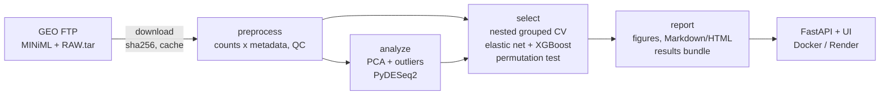
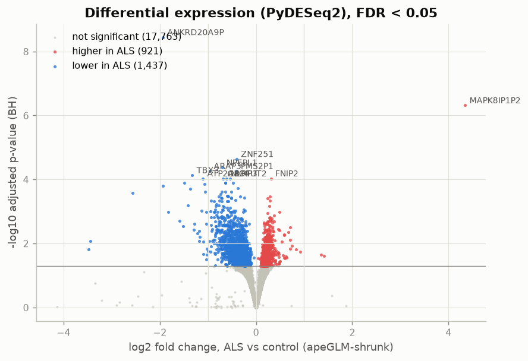

# ALS Insight: ML-driven biomarker discovery from RNA-seq

[](https://github.com/zeineeb33/ALS-Insight-Machine-Learning-Driven-Biomarker-Discovery/actions/workflows/ci.yml)

**Live demo:** https://als-insight.onrender.com (free Render instance: the first request after a period of inactivity can take up to a minute while it wakes up) · [API docs](https://als-insight.onrender.com/docs)

ALS Insight is a reproducible pipeline that ranks candidate biomarkers of amyotrophic lateral sclerosis (ALS) using RNA-seq from post-mortem human cortex (GEO [GSE124439](https://www.ncbi.nlm.nih.gov/geo/query/acc.cgi?acc=GSE124439)). It downloads the public data with checksum checks, runs QC, PCA-based outlier detection and PyDESeq2 differential expression, and evaluates elastic-net and XGBoost classifiers with **nested cross-validation grouped by donor, so no information leaks between training and test folds**. It then combines statistical and model evidence into one ranked gene list. A FastAPI service with a small web UI serves the versioned results, and it fits on Render's free tier.

> **Disclaimer:** this is a research and educational analysis of public data. It is not a diagnostic tool and not medical advice.



## Features

- **Config-driven, cached pipeline**: a typer CLI (`als-insight download|preprocess|analyze|select|report|run`) reads a YAML config validated by pydantic. Each step is content-addressed, so it re-runs only when its config section or inputs change.
- **Leakage-free ML**: low-count filtering, DESeq2 median-of-ratios normalisation, ANOVA pre-selection and scaling are scikit-learn transformers inside the CV pipeline. Outer and inner folds use `StratifiedGroupKFold` on donor ID. An optional donor-level label-permutation test re-runs the full nested CV.
- **Biomarker evidence**: PyDESeq2 (`~ region + condition`, apeGLM shrinkage, BH FDR), selection stability across folds (frequency and Jaccard), and a consensus rank built from DE and model evidence.
- **Serving**: FastAPI with pydantic schemas and OpenAPI docs, plus a one-page Plotly UI (gene search, volcano plot, PCA, top candidates). At runtime it uses only the standard library and FastAPI, with no numpy or pandas.
- **Engineering**: `uv` lockfile, ruff, mypy, pytest on synthetic GEO fixtures (no network access), GitHub Actions CI with a Docker smoke test, a multi-stage non-root image and a Render Blueprint.

## Project structure

```
configs/default.yaml        # every analysis parameter (validated)
src/als_insight/
  download.py geo.py        # GEO fetch + MINiML / count-archive parsers
  preprocess.py             # contrast, region covariate, QC, low-count filter
  normalization.py          # fold-safe sklearn transformers
  exploration.py differential.py analyze.py   # PCA/outliers, PyDESeq2
  modeling.py consensus.py selection.py       # nested CV, permutation, ranking
  figures.py report.py      # report + versioned results bundle
  serving/                  # FastAPI app, results store, static UI
results/                    # versioned bundle served by the API (committed)
reports/                    # generated report + figures (committed)
notebooks/                  # original university notebook
tests/                      # synthetic-data unit and end-to-end tests
```

## Quickstart

```bash
uv sync --all-extras                      # Python 3.12
uv run pytest --cov                       # tests (no network)
uv run uvicorn --factory als_insight.serving.app:create_app --port 8000   # serve committed results
# or
docker build -t als-insight . && docker run -p 8000:8000 als-insight
```

Open http://localhost:8000 for the UI and http://localhost:8000/docs for the API reference.

### Reproduce the full analysis

```bash
uv run als-insight run --config configs/default.yaml
```

This downloads about 22 MB from NCBI GEO into `data/` and writes intermediates to `artifacts/` (both gitignored). It then regenerates `reports/` and `results/`. On an 8-core laptop the run took about 1 min for DESeq2, about 5 min for the nested CV. To add a donor-level permutation test, set `selection.permutation.n_permutations` (for example 50); it is off by default because it re-runs the full nested CV for every permutation.

## API examples

```bash
curl localhost:8000/health
curl localhost:8000/genes/TBX3                 # DE stats, model importances, ranks
curl "localhost:8000/biomarkers?top=10"        # consensus top-N
curl "localhost:8000/genes?q=ANK"              # symbol search
curl localhost:8000/plots/volcano              # data behind the plots
```

## Results (GSE124439, `configs/default.yaml`)

All numbers come from `als-insight run` on the full public dataset. The machine-readable version is [`results/manifest.json`](results/manifest.json) and the full report is [`reports/report.md`](reports/report.md).

- **Data**: 176 annotated samples. The contrast is *ALS Spectrum MND* (145 samples, 76 donors) vs *Non-Neurological Control* (17 samples, 12 donors); the 14 *Other Neurological Disorders* samples are excluded. That leaves 162 samples from 88 donors (frontal and motor cortex) and 28,953 features (genes plus 992 transposable elements), of which 20,121 pass the low-count filter.
- **Exploration**: 1 PCA outlier (GSM3533325, robust z = 3.86) is excluded, leaving 161 samples.
- **Differential expression** (PyDESeq2, `~ region + condition`): **2,358 / 20,121 features at FDR < 0.05** (921 up and 1,437 down in ALS). Of these, 59 have |log2FC| ≥ 1 using the MLE estimate, and 32 after apeGLM shrinkage. The top hits are ANKRD20A9P, MAPK8IP1P2, ZNF251, NPEPL1, PMS2P1, ARAP3 and TBX3.
- **Classification** (5-fold × 3-repeat nested CV, grouped by donor, positive class = ALS):

  | Model | ROC AUC | Balanced acc. | Sensitivity | Specificity |
  |---|---|---|---|---|
  | Elastic net | 0.698 ± 0.195 | 0.598 ± 0.151 | 0.940 ± 0.038 | 0.256 ± 0.313 |
  | XGBoost | 0.695 ± 0.229 | 0.621 ± 0.161 | 0.986 ± 0.022 | 0.256 ± 0.313 |

  The permutation test was not run for the committed results (`n_permutations: 0`).
- **Top consensus candidates**: GBP4, TCHH, SLC2A14, ANKRD20A9P, COLEC11, PKD1L3, ATP2A1, GIMAP7, C2orf74, GUF1. The full table is in `results/genes.csv.gz` and the report.

The signal is modest. The original notebook reported 100% training accuracy and a single 60/40 split, but honest donor-grouped evaluation gives an AUC of about 0.70 with wide fold-to-fold variance, because only 12 control donors exist. Controls are hard to recognise: specificity is about 0.26 at the default 0.5 threshold.



## Engineering decisions and trade-offs

- **No leakage.** Gene filtering, normalisation, feature selection and scaling are fitted inside each training fold. Hyper-parameters are tuned only on inner folds. Folds are grouped by donor, because 1–3 cortex regions come from the same person. A pure-noise test (`tests/test_modeling.py`) checks that the AUC stays near 0.5.
- **What stays global.** Sample-level outlier removal (label-agnostic) and DE on all retained samples are global, so they are used only for description and ranking, never for performance estimates.
- **Known limitation.** DESeq2 treats multiple samples from one donor as independent (it has no random effects), so its p-values are optimistic. The donor-grouped CV is the more conservative evidence.
- **Lean deployment.** The app serves precomputed, deterministic files (`results/`) instead of running models, so the runtime image needs no scientific stack. It runs a single worker for 512 MB / 0.1 CPU. No predictive model is deployed, on purpose: this is not a diagnostic tool.

## Deployment on Render

1. Push the repository to GitHub.
2. In the Render dashboard, choose **New → Blueprint** and select this repository. `render.yaml` defines a free Docker web service with `healthCheckPath: /health` and auto-deploy.
3. The free tier sleeps when idle, so the first request after a while takes a few seconds.

## Roadmap

- Donor-level (pseudo-bulk) or mixed-model DE to remove pseudo-replication.
- Threshold calibration and cost-sensitive operating points for the minority control class.
- External validation on an independent ALS cortex cohort.
- Pathway and enrichment analysis of the consensus list.

## Background

This started as an L3 Informatique bioinformatics project at Université Paris-Saclay (2025). The original exploratory notebook (preprocessing, PCA, t-SNE/UMAP, PyDESeq2, Elastic-Net) is kept in [`notebooks/`](notebooks/).

**Data**: Tam OH et al. *Postmortem Cortex Samples Identify Distinct Molecular Subtypes of ALS: Retrotransposon Activation, Oxidative Stress, and Activated Glia.* Cell Reports 29(5):1164–1177 (2019), doi:10.1016/j.celrep.2019.09.066 (GEO GSE124439).

License: [MIT](LICENSE).
