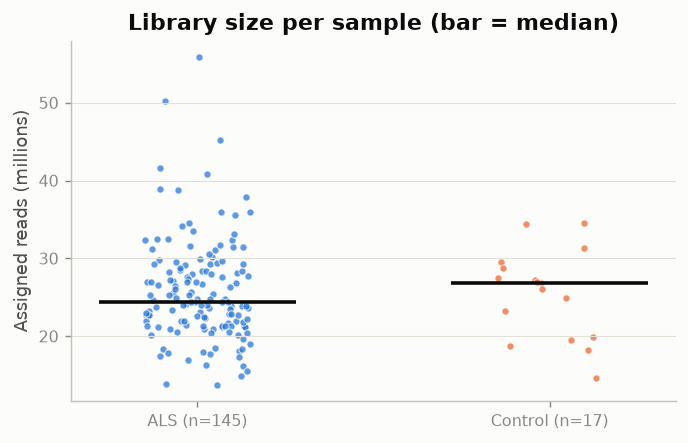
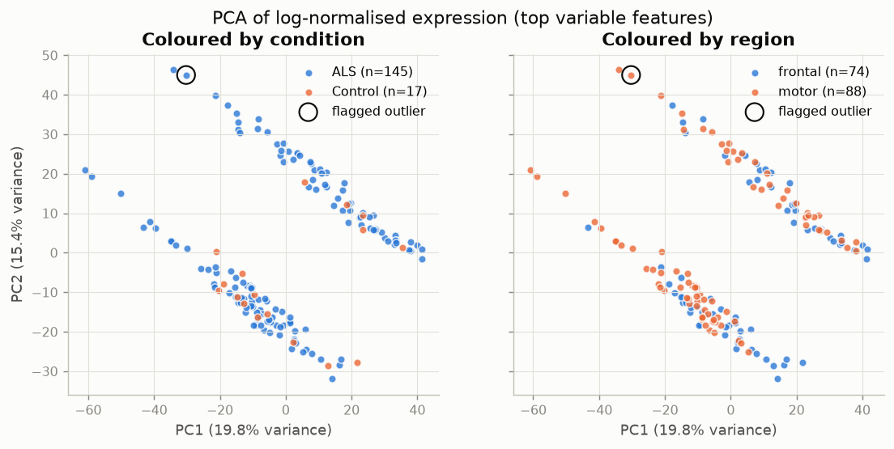
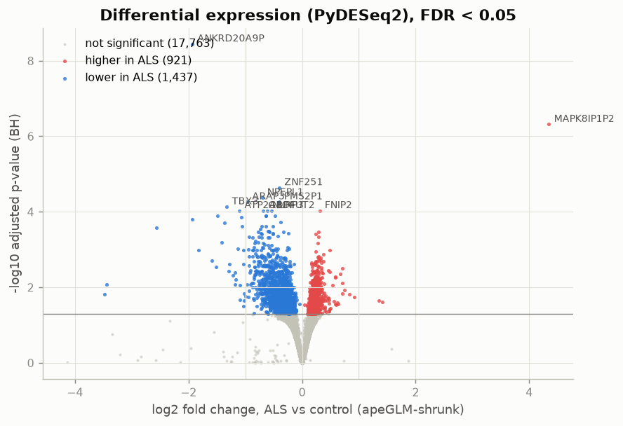
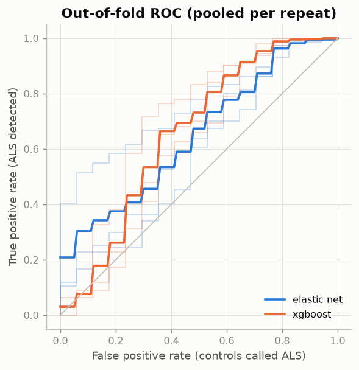
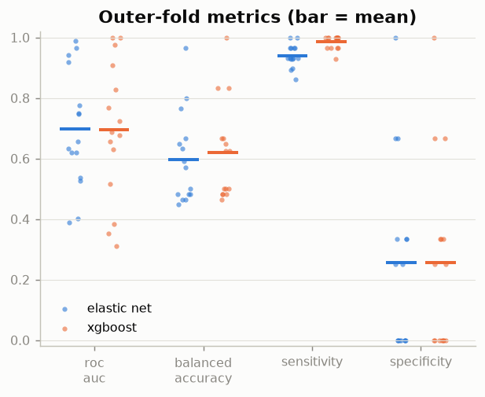
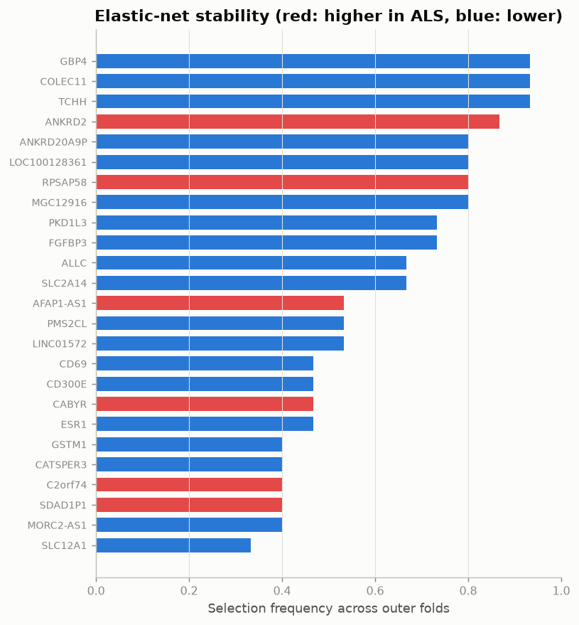
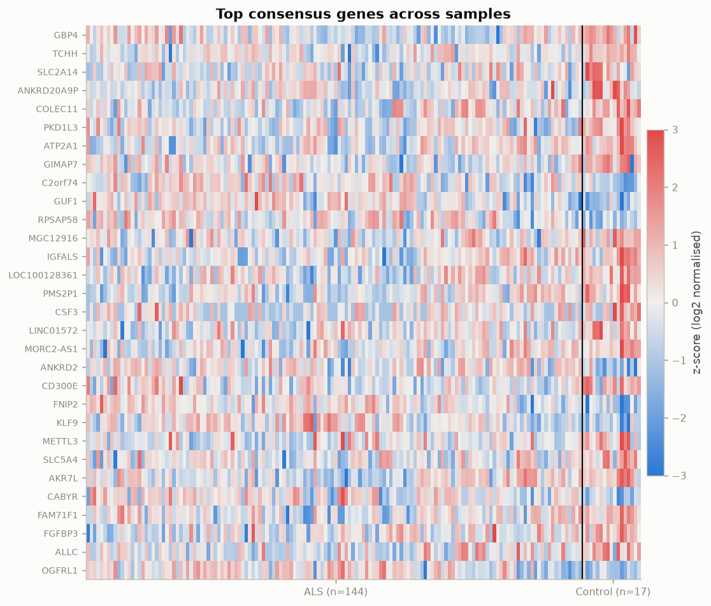

# ALS Insight report: GSE124439

_Research and educational analysis of public data. Not a diagnostic tool and not medical advice; candidate genes are statistical associations that require independent validation._

## Dataset and quality control

Contrast **ALS Spectrum MND** (ALS) vs **Non-Neurological Control** (Control). 162 samples from 88 donors ({'ALS': 145, 'Control': 17}; donors {'ALS': 76, 'Control': 12}), 28,953 features (992 transposable elements), 20,121 passing the low-count filter (>= 10 reads in >= 10% of samples). Median library size 24.8 M assigned reads.

## Exploration

PCA on the 1000 most variable log-normalised features. Outliers are samples whose Mahalanobis distance in the first 4 PCs has a robust z-score > 3.5: **GSM3533325** (excluded downstream).

## Differential expression (PyDESeq2)

Design `~ region + condition`, Wald test, Benjamini-Hochberg FDR. On 161 samples, **2,358 of 20,121** features have FDR < 0.05 (921 higher, 1,437 lower in ALS); 32 also have |shrunk log2FC| >= 1.0 (59 using the unshrunk MLE).

## Multivariate selection with nested, donor-grouped cross-validation

3x repeated 5-fold outer CV with 3-fold inner CV for hyper-parameters, both stratified and grouped by donor. Filtering, normalisation, ANOVA pre-selection of 1000 features and scaling are re-fitted inside every training fold. Positive class: ALS.

| Model | ROC AUC | Balanced acc. | Sensitivity | Specificity | MCC | Jaccard |
|---|---|---|---|---|---|---|
| elastic net | 0.698 ± 0.195 | 0.598 ± 0.151 | 0.940 ± 0.038 | 0.256 ± 0.313 | 0.181 ± 0.282 | 0.142 |
| xgboost | 0.695 ± 0.229 | 0.621 ± 0.161 | 0.986 ± 0.022 | 0.256 ± 0.313 | 0.316 ± 0.379 | 0.112 |

## Consensus biomarker candidates

Weighted mean of normalised ranks from DE p-values, elastic-net mean |coefficient| and XGBoost mean gain across outer folds (weights {'de': 1.0, 'elastic_net': 1.0, 'xgboost': 1.0}).

| Rank | Gene | log2FC | padj | EN freq. | EN coef | XGB freq. | Consensus |
|---|---|---|---|---|---|---|---|
| 1 | GBP4 | -0.68 | 9.35e-05 | 0.93 | -0.215 | 0.73 | 4.47e-04 |
| 2 | TCHH | -0.60 | 4.89e-04 | 0.93 | -0.162 | 0.93 | 9.11e-04 |
| 3 | SLC2A14 | -1.36 | 1.95e-04 | 0.67 | -0.105 | 0.53 | 0.0013 |
| 4 | ANKRD20A9P | -1.93 | 3.60e-09 | 0.80 | -0.150 | 0.60 | 0.0015 |
| 5 | COLEC11 | -1.14 | 9.54e-04 | 0.93 | -0.181 | 0.67 | 0.0017 |
| 6 | PKD1L3 | -0.78 | 6.40e-04 | 0.73 | -0.111 | 0.53 | 0.0018 |
| 7 | ATP2A1 | -1.10 | 9.35e-05 | 0.33 | -0.017 | 0.40 | 0.0019 |
| 8 | GIMAP7 | -0.71 | 2.40e-04 | 0.20 | -0.021 | 0.67 | 0.0020 |
| 9 | C2orf74 | 0.38 | 0.001 | 0.40 | 0.050 | 0.73 | 0.0021 |
| 10 | GUF1 | 0.29 | 3.46e-04 | 0.13 | 0.012 | 0.80 | 0.0023 |
| 11 | RPSAP58 | 0.49 | 0.001 | 0.80 | 0.116 | 0.53 | 0.0024 |
| 12 | MGC12916 | -0.86 | 0.001 | 0.80 | -0.095 | 0.87 | 0.0025 |
| 13 | IGFALS | -0.93 | 4.61e-04 | 0.27 | -0.025 | 0.47 | 0.0029 |
| 14 | LOC100128361 | -0.61 | 0.001 | 0.80 | -0.119 | 0.53 | 0.0031 |
| 15 | PMS2P1 | -0.41 | 5.47e-05 | 0.13 | -0.006 | 0.27 | 0.0038 |
| 16 | CSF3 | -2.56 | 2.62e-04 | 0.27 | -0.037 | 0.33 | 0.0040 |
| 17 | LINC01572 | -0.60 | 3.29e-04 | 0.53 | -0.055 | 0.40 | 0.0041 |
| 18 | MORC2-AS1 | -0.74 | 0.002 | 0.40 | -0.026 | 0.40 | 0.0042 |
| 19 | ANKRD2 | 0.71 | 0.003 | 0.87 | 0.228 | 0.80 | 0.0044 |
| 20 | CD300E | -1.18 | 0.004 | 0.47 | -0.068 | 0.73 | 0.0048 |
| 21 | FNIP2 | 0.31 | 9.35e-05 | 0.20 | 0.007 | 0.13 | 0.0049 |
| 22 | KLF9 | 0.33 | 0.002 | 0.13 | 0.008 | 0.47 | 0.0050 |
| 23 | METTL3 | -0.21 | 0.002 | 0.13 | -0.012 | 0.40 | 0.0051 |
| 24 | SLC5A4 | -1.03 | 0.002 | 0.33 | -0.029 | 0.20 | 0.0052 |
| 25 | AKR7L | -0.66 | 0.002 | 0.13 | 0.006 | 0.33 | 0.0054 |

## Reproducibility

Generated by `als-insight run --config configs/default.yaml` (package 0.1.0). Raw counts archive sha256 `c7f26b44797a654703f71e4dfb200022416f6d430e2d0ee1999335d305310e3c`.

Data: Tam OH et al. Postmortem Cortex Samples Identify Distinct Molecular Subtypes of ALS: Retrotransposon Activation, Oxidative Stress, and Activated Glia. Cell Reports 29(5):1164-1177 (2019). doi:10.1016/j.celrep.2019.09.066
